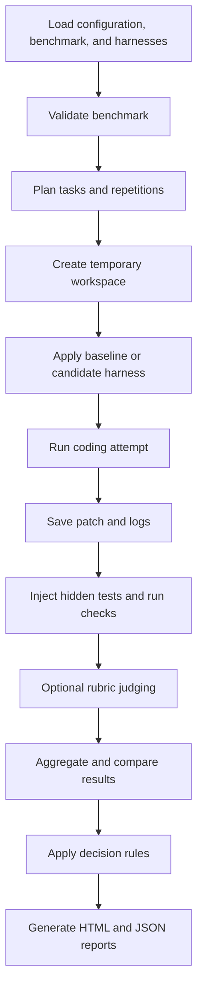

# Agent Eval Lab: complete project explanation and client demo walkthrough

This document explains the project from its business purpose through its code,
execution workflow, reports, and client demonstration. It expands on the shorter
[client demo guide](client-demo-guide.md).

The repository inspection and verification results recorded here are from
September 30, 2026. They describe this local checkout at that time.

## Contents

1. [What the project does](#1-what-the-project-does)
2. [Application type and technology](#2-application-type-and-technology)
3. [Repository structure](#3-repository-structure)
4. [The included experiment](#4-the-included-experiment)
5. [End-to-end evaluation workflow](#5-end-to-end-evaluation-workflow)
6. [Metrics, statistics, and decisions](#6-metrics-statistics-and-decisions)
7. [Simulated, real, and replay execution](#7-simulated-real-and-replay-execution)
8. [Stored evidence and report sections](#8-stored-evidence-and-report-sections)
9. [Results verified in this checkout](#9-results-verified-in-this-checkout)
10. [Commands for your demonstration](#10-commands-for-your-demonstration)
11. [Client presentation walkthrough](#11-client-presentation-walkthrough)
12. [Current scope and limitations](#12-current-scope-and-limitations)
13. [Client status update](#13-client-status-update)
14. [Suggested learning order and common questions](#14-suggested-learning-order-and-common-questions)

## 1. What the project does

**agent-eval answers: "If we change a coding agent's instructions or settings, does
it actually produce better results?"**

Imagine a team currently gives its coding agent these instructions:

> Write the code, run the tests, and keep it tidy.

The team proposes more detailed instructions:

> Read existing code first, reuse its validation helpers, follow its error-handling
> conventions, and preserve compatibility.

Those instructions sound useful, but the team needs evidence before rolling them
out. Additional instructions might improve some tasks, break others, or increase
cost without providing a clear benefit.

agent-eval runs the same coding tasks under both setups, repeats the attempts,
checks the resulting code, and generates a report explaining the comparison.

### Key vocabulary

| Term | Meaning |
|---|---|
| Agent | The coding tool that performs the work, such as Claude Code |
| Model | The language model used by the agent |
| Harness | Instructions, skills, permissions, and configuration around the agent |
| Baseline | The existing harness |
| Candidate | The proposed harness |
| Arm | One side of the experiment: baseline or candidate |
| Benchmark | A starting codebase and a collection of coding tasks |
| Fixture | The starting codebase copied into each temporary workspace |
| Task | One coding requirement, such as adding pagination |
| Repetition | Another attempt at the same task under the same harness |
| Run | One task attempted once under one harness |
| Judge | An optional rubric-based assessment of the code change |
| Artifact | A saved patch, log, result, or other evidence file |

### Business value

The report helps a team decide whether to adopt a proposed harness change. It
shows what improved, what regressed, what usage was reported, and how uncertain
the comparison is. It can also say that there is insufficient evidence to decide.

The tool does not automatically deploy the candidate harness or train a model.

## 2. Application type and technology

This is a **Python command-line application that generates a static HTML report**.
You run commands in a terminal and open the generated report in a browser.

The customer-records service under `benchmarks/` is sample code used to test agents.
The main product is the evaluator, not that customer service.

| Technology | Purpose |
|---|---|
| Python 3.11+ | Application implementation |
| Typer | Command-line commands and options |
| Rich | Terminal tables, progress, and formatted output |
| Pydantic | Validated settings and structured results |
| YAML | Experiment, harness, and task configuration |
| Git | Workspace baselines and code differences |
| pytest | Functional verification and evaluator tests |
| Ruff | Lint checks |
| mypy | Type checks |
| Jinja2 | HTML report generation |
| JSON and plain logs | Saved evaluation evidence |
| SQLite | Rebuildable index over stored results |
| Claude Code | Included live coding-agent integration |

The package version inspected was `0.1.0`. There is no hosted dashboard or login
system in this project.

## 3. Repository structure

### Top-level folders

| Location | What it contains |
|---|---|
| `src/agent_eval/` | The evaluation application |
| `benchmarks/` | Sample codebase, tasks, verification tests, and reference solutions |
| `harnesses/` | Baseline and candidate instructions and settings |
| `examples/` | Offline and real-agent evaluation configurations |
| `tests/` | Tests for the evaluator itself |
| `docs/` | Architecture, decisions, development history, and demo guidance |
| `skills/` | Written procedures for reviewing evaluations and investigating regressions |
| `runs/` | Generated reports, patches, logs, and results; excluded from Git |
| `pyproject.toml` | Package dependencies, CLI entry point, and developer-tool settings |
| `AGENTS.md` | Repository rules for agents working on the evaluator |

### Main application modules

The following paths are relative to `src/agent_eval/`:

| File or module | Responsibility |
|---|---|
| `cli.py` | Exposes commands and coordinates the workflow |
| `config.py` | Loads and validates evaluation settings |
| `models.py` | Defines structured data passed between stages |
| `benchmark.py` | Loads benchmark definitions and tasks |
| `doctor.py` | Validates that benchmark tasks are meaningful and solvable |
| `harness.py` | Snapshots, identifies, and compares harness contents |
| `workspace.py` | Creates temporary Git workspaces and handles protected paths |
| `execution.py` | Executes one task attempt and saves its evidence |
| `runners/` | Simulated, Claude Code, and replay adapters |
| `checks/` | Runs objective verification commands |
| `judge/`, `judging.py` | Rubrics, judge providers, and stored-patch assessment |
| `metrics.py` | Aggregates runs and compares task results |
| `stats.py` | Calculates statistical intervals and resolving power |
| `decide.py` | Applies ordered rules to determine the verdict |
| `store.py` | Saves and reloads artifact files and supports indexing |
| `pipeline.py` | Coordinates aggregation, decision, and report generation |
| `report/` | Builds report data and renders HTML |
| `redact.py` | Redacts recognized sensitive values before persistence |
| `env.py` | Handles environment configuration |
| `progress.py` | Provides execution progress information |

### Inside the sample benchmark

```text
benchmarks/py-customers/
    benchmark.yaml
    fixture/
        src/customers/
        tests/
        pyproject.toml
    tasks/
        t01-export-csv/
        t02-fix-lookup-bug/
        t03-validate-import/
        t04-paginate-list/
        t05-refactor-filtering/
```

The fixture includes customer models, application errors, reusable validators,
an in-memory repository, and a service API.

Each task generally contains:

| Item | Purpose |
|---|---|
| `task.yaml` | Prompt, identity, and task-specific settings |
| `rubric.md` | Criteria used to judge the patch |
| `verify/` | Hidden verification tests injected after the agent stops |
| `reference/` | Known-good whole-file solution used by benchmark validation |
| `simulations/` | Prepared code attempts used by the offline demo |

The evaluator's own tests in the root `tests/` folder are different from both the
fixture tests and the task verification tests.

## 4. The included experiment

### Baseline harness

The baseline [AGENTS.md](../harnesses/baseline/AGENTS.md) gives short instructions:
run tests and keep code tidy.

### Candidate harness

The candidate [AGENTS.md](../harnesses/candidate/AGENTS.md) adds instructions to:

- Read nearby code before making changes.
- Reuse existing helpers and established conventions.
- Preserve existing function callers unless a breaking change was requested.
- Follow type-hint and documentation conventions.
- Run tests, lint, and type checks.

It also adds a [repository-conventions skill](../harnesses/candidate/.claude/skills/repo-conventions/SKILL.md)
covering error handling, validation, test factories, compatibility, and verification.

Both harness manifests declare the same model and agent settings. The intended
experiment therefore focuses on the instruction changes.

### The five tasks

| Task | Requirement | Property being examined |
|---|---|---|
| CSV export | Export customers with the existing filters | Implementing a missing feature |
| Customer lookup | Fail clearly when an ID does not exist | Fixing a bug using appropriate error conventions |
| Import validation | Validate rows and add tests | Following a requirement with multiple parts |
| Pagination | Add limit and offset while preserving existing callers | Extending an API safely |
| Filtering refactor | Extract reusable matching logic | Preserving behavior during refactoring |

Each task runs three times under each harness:

```text
5 tasks x 3 repetitions x 2 harnesses = 30 runs
```

Real agents can produce different outputs for repeated attempts. Repetition helps
show whether an outcome is consistent or only occurred once.

## 5. End-to-end evaluation workflow



If your Markdown viewer does not render Mermaid, the numbered steps below describe
the same workflow.

### Step 1: Load configuration

The YAML configuration selects the benchmark, baseline, candidate, repetitions,
execution adapter, judge, output directory, and decision thresholds.

See [examples/demo.yaml](../examples/demo.yaml) for the offline example. Relative
paths in this configuration are resolved against the configuration file's folder.

### Step 2: Validate the benchmark

The `doctor` command checks that:

1. The unchanged fixture fails the task's correctness checks.
2. The unchanged fixture passes the objective quality checks.
3. Applying the reference solution makes all required checks pass.

This catches an already-solved task that would produce meaningless success, an
unsolvable task that would produce meaningless failure, and pre-existing quality
problems that could otherwise be blamed on the agent.

`evaluate` performs this validation automatically unless explicitly skipped.

### Step 3: Plan execution

The plan identifies every task, harness, repetition, and execution position. The
demo uses interleaved ordering: baseline and candidate attempts are run close
together to reduce the effect of conditions drifting during a real experiment.

Harness contents receive a content-based identity, so changes can be traced even
when they have not been committed to Git.

### Step 4: Create a temporary workspace

Each attempt starts from a fresh copy of the fixture in a temporary Git workspace.
The selected harness is overlaid onto that workspace.

Harness files are excluded from the patch being evaluated so they do not inflate
the apparent code changes or expose the comparison identity to the judge.

A temporary directory protects the original working tree from direct edits; it is
not a container or a complete security boundary.

### Step 5: Execute the coding attempt

The adapter either invokes Claude Code, applies a prepared simulated attempt, or
replays a recorded patch. The task prompt tells the agent what to implement.

The system captures the resulting code difference, logs, execution status, and
reported usage. The patch is captured before hidden verification files are added.

### Step 6: Protect existing verification inputs

Modifications or deletions to protected existing files are restored before checks
run. Such changes are recorded as tampering for review.

Newly added tests can remain, because some tasks legitimately require the agent
to write tests. The protection is intended to prevent weakening existing checks.

### Step 7: Inject hidden tests and run objective checks

Task verification files are copied into the workspace only after the agent stops.
This helps evaluate whether it solved the requirement without giving it the grader.

The benchmark runs hidden functional verification, Ruff, and mypy. The refactoring
task also requires a source-code change so that doing nothing cannot pass merely
by preserving existing behavior.

### Step 8: Optionally judge the patch

The judge receives the task, rubric, patch, and repository context. It does not
receive the test results or the baseline/candidate identity.

Keeping test results out of judging helps prevent one positive signal from being
counted twice. The judge is an additional assessment, not an infallible authority.

### Step 9: Aggregate and compare

The system first aggregates repetitions within each task and harness. It then
compares the baseline and candidate on matching tasks and calculates uncertainty.

### Step 10: Decide and report

Ordered decision rules produce a verdict and reasons. The final outputs include
machine-readable JSON and a self-contained HTML report.

Stored run evidence allows reports to be rebuilt without another coding-agent run.
The current report path also reloads benchmark, harness, and configuration inputs,
so retain those inputs when reproducing an evaluation.

Re-judging saved patches also avoids rerunning the coding agent. A network judge
can still incur usage and produce a different assessment.

## 6. Metrics, statistics, and decisions

### Five separate dimensions

| Dimension | Question answered |
|---|---|
| Functional correctness | Did the task pass its objective verification checks? |
| Requirement adherence | Does the patch satisfy the written requirement and rubric? |
| Quality and conventions | Does it pass lint/type checks and fit repository patterns? |
| Efficiency | What duration, tokens, cost, and turns were reported? |
| Reliability | How consistent were repeated pass/fail outcomes? |

Reliability does not mean success: an agent that fails every time is consistent
but unsuccessful. Interpret it alongside correctness.

Measured checks and judged assessments remain separate in the report. Missing
usage is unavailable rather than zero. Simulated usage is labeled simulated.

### Why repetitions do not create independent tasks

Three attempts at the same task share the same starting code and requirement.
They are not equivalent to three different tasks.

The statistical comparison therefore works at the task level:

```text
Repeated runs -> per-task results -> comparison across tasks
```

With five tasks and three repetitions per harness, the effective number of task
comparisons is five, not fifteen. Paired bootstrap intervals express uncertainty
in the baseline-to-candidate differences.

For presentation purposes, explain an interval as the range of differences the
evaluation's statistical procedure considers plausible. If it includes zero, the
observed improvement does not clearly exclude no change.

### Decision rules

There is no weighted overall score. The system applies rules covering:

1. Whether the comparison is valid.
2. Whether a critical task regressed.
3. Whether integrity or disagreement findings require human review.
4. Whether correctness changed enough to satisfy the configured threshold.
5. Whether cost, duration, quality, reliability, or judged guardrails were breached.
6. Whether there are enough tasks to support a verdict.

The default correctness materiality threshold is 20 percentage points. An observed
20-point improvement alone does not establish that threshold; uncertainty matters.

| Verdict | Interpretation |
|---|---|
| `POSITIVE` | The configured rules support a benefit |
| `NEGATIVE` | A regression or unacceptable trade-off was detected |
| `INCONCLUSIVE` | Evidence does not support an actionable conclusion |
| `NOT_COMPARABLE` | The experiment cannot support a controlled comparison |

Manual review is a separate flag. A critical task regression can veto an average
gain. `INCONCLUSIVE` is a legitimate outcome, not an execution failure.

## 7. Simulated, real, and replay execution

| Mode | What happens |
|---|---|
| Simulated | Prepared code changes are applied; real checks run; usage figures are declared |
| Real agent | Claude Code performs coding work in temporary workspaces |
| Replay | Recorded patches are applied and checked again, with recorded usage |

### Offline demo

[demo.yaml](../examples/demo.yaml) uses prepared coding attempts, real workspaces,
real patches, real verification/lint/type checks, simulated duration/token/cost
figures, and a rule-based heuristic judge. It requires no API key.

**Changing the harness in this mode does not measure a live model's response to
those instructions.** The prepared attempts demonstrate the evaluation machinery.

The simulated durations printed for individual runs are not the actual time you
must wait for those runs during the demo.

### Live evaluation

[real.yaml](../examples/real.yaml) configures Claude Code for execution and judging.
It requires the configured CLI and credentials and involves provider usage.

The selected provider processes the relevant repository content. The example uses
the same model family for coding and judging, which is a potential assessment bias.
A configuration file by itself is not evidence of a successful live evaluation.

### Replay

Replay requires existing recordings. It allows the recorded patches to be applied
to fresh workspaces and checked without requesting new coding attempts. It does
not measure fresh agent behavior or current API latency.

## 8. Stored evidence and report sections

### Artifact layout

```text
runs/<evaluation-id>/
    metadata.json
    plan.jsonl
    runs/<task>/<arm>/rep-NN/
        run.json
        stdout.log
        stderr.log
        diff.patch
        checks.json
        judge.json
        agent_raw.json
    summary.json
    report.json
    report.html
```

Judgment artifacts depend on whether judging is performed. These files let a
reviewer trace a report finding to the underlying run evidence.

SQLite is a rebuildable index. The artifact files hold the authoritative evidence.
Deleting the index should not erase the experiment results.

### HTML report sections

| Section | What to explain to the client |
|---|---|
| Executive conclusion | Verdict, reasons, thresholds, and review flags |
| Harness changes | What changed between the two configurations |
| Metrics | Measured and judged dimensions, differences, and uncertainty |
| Per-task results | Where individual tasks improved or worsened |
| Regressions and improvements | Findings that deserve attention |
| Measured/judged disagreement | Where checks and rubric assessment point in different directions |
| Manual review queue | Findings requiring human interpretation |
| Every run | Individual attempts and supporting artifacts |
| Limitations | Boundaries on what the evidence can establish |
| Reproducing the evaluation | Recorded context for repeating or inspecting the work |

## 9. Results verified in this checkout

The full offline evaluation completed successfully on September 30, 2026.

- Evaluation ID: the timestamped ID printed by `agent-eval evaluate`
- Generated HTML and JSON reports are written under `runs/<evaluation-id>/` (the `runs/`
  directory is intentionally ignored because artifacts contain evaluated code).

These links point to local, Git-ignored artifacts. They will not exist in another
checkout unless those artifacts are separately retained or a new evaluation is run.

### Observed demo results

| Metric | Baseline | Candidate |
|---|---:|---:|
| Correctness | 60.0% | 73.3% |
| Objective quality | 100.0% | 100.0% |
| Reliability | 80.0% | 93.3% |
| Heuristic requirement score | 3.38 | 3.62 |

The verdict was **NEGATIVE** because:

- Correctness increased by 13.3 percentage points, but its interval ranged from
  approximately -13.3 to +46.7 percentage points. That did not establish a material
  correctness benefit.
- Simulated cost increased approximately 46.4%, exceeding the 15% tolerance.
- Simulated duration increased approximately 58.4%, exceeding the 25% tolerance.

A useful explanation is:

> The candidate has a higher observed pass rate, but the system checks whether the
> improvement is convincing and whether the additional cost is acceptable. In this
> simulated example, the decision rules reject the trade-off.

**These are demonstration results, not evidence about a real agent's performance.**

### Other verification performed

| Check | Result |
|---|---|
| Benchmark validation within evaluation | Passed |
| Complete offline evaluation | All 30 runs completed and report generated |
| Report rebuild from stored results | Succeeded |
| Ruff on `src/` and `tests/` | Passed |
| mypy on `src/agent_eval` | Passed across 30 source files |
| Evaluator test collection | 207 tests collected |
| Full evaluator test suite | Not run during this explanation task |

Do not describe test collection as 207 passing tests. Also, successful evaluator
execution does not mean all benchmark attempts passed; failed attempts are part
of the evidence the evaluator is designed to capture.

## 10. Commands for your demonstration

Run these PowerShell commands from your `agent-eval-lab` checkout. They use the existing virtual
environment and do not require activating it.

### List the benchmark tasks

```powershell
.\.venv\Scripts\agent-eval.exe tasks -b benchmarks/py-customers
```

### Validate the benchmark

```powershell
.\.venv\Scripts\agent-eval.exe doctor -b benchmarks/py-customers
```

### Run the offline evaluation

```powershell
.\.venv\Scripts\agent-eval.exe evaluate -c examples/demo.yaml
```

This command also validates the benchmark automatically. Open the exact
`report.html` path printed when it finishes. Each new evaluation has its own ID.

### Rebuild the verified report without another coding-agent run

```powershell
.\.venv\Scripts\agent-eval.exe report -c examples/demo.yaml
```

For a new evaluation, substitute its generated ID. Explicit selection avoids
accidentally presenting a different evaluation when several are stored.

### Inspect one attempt and its code changes

```powershell
.\.venv\Scripts\agent-eval.exe show RUN_ID -c examples/demo.yaml --diff
```

### Rebuild the optional index

```powershell
.\.venv\Scripts\agent-eval.exe index -o runs
```

### Run a live evaluation when its prerequisites are ready

```powershell
.\.venv\Scripts\agent-eval.exe evaluate -c examples/real.yaml
```

This last command is not the offline demo: it invokes the configured live agent
and judge. Confirm credentials, provider access, and suitability of the code being
processed before using it for a client evaluation.

## 11. Client presentation walkthrough

Plan approximately 10 minutes. Prepare the completed report beforehand so the
presentation does not depend on execution speed.

### Step 1: Explain the business problem

Say:

> We need evidence before changing the coding-agent setup used by the team. This
> tool compares the current setup and a proposed setup on the same coding tasks.

### Step 2: Show the two harnesses

Open the baseline and candidate `AGENTS.md` files. Point out the new requirements
to reuse helpers, follow conventions, and preserve compatibility. Show the added
repository-conventions skill.

Explain that the example keeps model and agent settings the same to focus on the
instruction changes.

### Step 3: Show one benchmark task

Pagination is a useful example because it asks for new functionality while retaining
compatibility with existing callers. Show its prompt and explain the role of its
verification tests and reference solution.

Say:

> The agent receives the requirement. Hidden verification tests are added after it
> finishes, so it cannot simply read the grader while implementing the change.

### Step 4: Show the configuration

Open `examples/demo.yaml`. Explain five tasks, three repetitions, two harnesses,
the simulated adapter, and the decision thresholds.

Say explicitly:

> This presentation uses prepared code attempts and simulated usage figures. The
> workspaces and code checks are real. A live evaluation is a separate step.

### Step 5: Run or show execution

Run the offline evaluation command if time permits. Explain the progress rows and
that individual benchmark failures are evaluation outcomes, not necessarily a
failure of the evaluator itself.

### Step 6: Walk through the report

Start with the verdict and its reasons. Then show harness changes, metrics,
uncertainty, and per-task results. Explain any disagreement or manual-review flags
that are present; do not imply every report must contain them.

Use the verified demo to explain why a higher observed pass rate does not
automatically justify rollout.

### Step 7: Show supporting evidence

Open one run's patch and check results, or use the `show --diff` command. Explain
that reviewers can investigate what produced a report finding.

If useful, rebuild the report from stored results to demonstrate that reporting
does not require another coding-agent execution.

### Step 8: Explain the next implementation step

Say:

> We would next introduce representative client tasks, agree on acceptance
> thresholds, validate the benchmark, and run the controlled live-agent comparison.

## 12. Current scope and limitations

The inspected version includes a working offline flow, stored evidence, statistical
comparison, HTML/JSON reporting, and a Claude Code integration.

Its current boundaries include:

- One small supplied Python benchmark with five tasks.
- One live coding-agent integration, plus simulation and replay.
- Sequential execution on one machine.
- Checks running in the evaluator's Python environment.
- Temporary workspaces rather than container isolation.
- No hosted dashboard or authentication system.
- No distributed execution or built-in resume/retry workflow.
- No human-calibrated judge assessment.

A small benchmark cannot establish performance across all client repositories.
A consistently scoring judge can still be wrong. An inconclusive result can mean
more representative tasks or repetitions are needed.

Do not promise production readiness, universal agent superiority, or client ROI
based on the offline demo.

## 13. Client status update

You can use the following wording:

> The project implements an end-to-end framework for comparing coding-agent
> configurations. We have verified the offline workflow, including benchmark
> validation, 30 evaluation runs, objective checks, comparison, and report
> generation. The next step is to introduce representative client tasks and
> validate the proposed configuration through live agent runs. The current demo
> illustrates the evaluation process; it does not yet establish production
> performance improvements.

For a shorter introduction:

> This tool helps us decide whether a proposed change to a coding agent's
> instructions is worth adopting, using repeatable tasks and inspectable evidence.

## 14. Suggested learning order and common questions

### Read these files in order

1. [README](../README.md): project purpose and major concepts.
2. [Demo configuration](../examples/demo.yaml): the experiment inputs.
3. [Baseline instructions](../harnesses/baseline/AGENTS.md) and
   [candidate instructions](../harnesses/candidate/AGENTS.md): the proposed change.
4. [Pagination task](../benchmarks/py-customers/tasks/t04-paginate-list/task.yaml):
   a concrete coding requirement.
5. The generated report under `runs/<evaluation-id>/report.html`: the user-facing result.
6. [CLI](../src/agent_eval/cli.py) and [execution](../src/agent_eval/execution.py):
   how the workflow runs.
7. [Metrics](../src/agent_eval/metrics.py), [statistics](../src/agent_eval/stats.py),
   and [decisions](../src/agent_eval/decide.py): how evidence becomes a verdict.
8. [Architecture](architecture.md) and [trust incident](trust-incident.md):
   design rationale and examples of evaluator defects found during development.

### Does this project build the client's application?

Its primary purpose is to evaluate coding-agent setups. A real agent builds or
changes benchmark code during an evaluation, and the evaluator measures the result.

### Why are both tests and a judge needed?

Tests check specified behavior. A rubric can examine requirements or conventions
that are not fully captured by those tests. Their signals remain separate because
either can be incomplete or mistaken.

### Why does the demo use prepared attempts?

It allows the entire evaluation workflow to be demonstrated without credentials
or live model usage. It demonstrates the mechanics, not live agent effectiveness.

### Does a NEGATIVE verdict mean the tool failed?

No. It means the decision rules rejected the candidate in that evaluation. Producing
an explained negative result is a successful execution of the evaluator.

### Why can a candidate with more passing runs still get NEGATIVE?

The apparent gain may be uncertain, while cost or other guardrails exceed accepted
limits. The verified demo illustrates that case using simulated usage figures.

### Can the report be generated again without rerunning the agent?

Yes. The `report` command uses saved run evidence. Retain the experiment's benchmark,
harness files, and configuration because the current implementation loads those too.

### What should happen before a client rollout decision?

Choose representative tasks, agree on thresholds, validate the benchmark, confirm
the live provider setup, run the real comparison, and investigate review findings.
